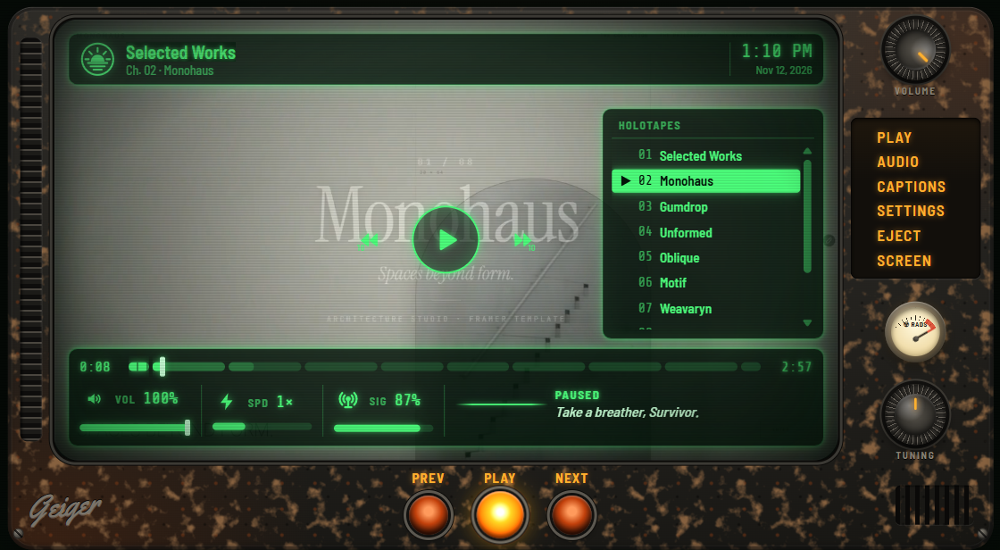

# Geiger

A Video.js v10 video skin for HTML, styled with CSS: the player as a survivor's field terminal after the end of the world. It started from the Scaffold skin.

**Live:** https://geiger-one.vercel.app · made for the Video.js Skins Design Challenge (Contra × Mux).

**Inspired by the Pip-Boy from the Fallout games.** Geiger is a fan tribute to that wrist computer: the green-phosphor screen, the amber side menu, the knobs and the rad gauge. All artwork, icons and code here are original. Fallout and Pip-Boy are trademarks of Bethesda Softworks LLC / ZeniMax Media; this project is not affiliated with or endorsed by them.



## Design

- **The device is the product.** The whole player is a rugged wrist terminal: a green-phosphor CRT in a rusted gunmetal housing, a ribbed rubber grip down the left, a side column on the right, and a chin of hardware keys below. CRT glass (scanlines, bloom, the curve of the tube) sits over everything the screen draws.
- **Real knobs** (`<geiger-knob>`). The VOLUME knob turns through 270° from silent to full. The TUNING knob is an endless dial that winds the tape 5 seconds per detent. Drag them round, scroll over them, or focus them and use the arrow keys; both are proper sliders for assistive technology.
- **The amber side plate.** PLAY, AUDIO, CAPTIONS, SETTINGS, EJECT (picture-in-picture) and SCREEN (fullscreen) are the device's main keys, with a lit marker beside whichever is on. On smaller players the grip and side column fold away and the status panel's own buttons take over.
- **It boots.** The poster reads "Welcome back, Survivor" in neon script. On the first play the tube powers on from a single bright line, runs a self-check, and hands over to the picture, with a synthesised power-up chirp.
- **Holotapes are chapters** (`<geiger-tapes>`). Pause and the chapters appear as a list of real buttons, the current one lit; pick one to wind there and play. The header names the chapter playing (`<geiger-chapter>`).
- **Vitals you can use.** VOL's bar is the volume slider. SPD (`<geiger-rate>`) steps the speed. SIG (`<geiger-signal>`) shows how much tape is buffered ahead. A heartbeat runs while the tape plays, races at 2×, slows at 0.5× and flatlines on pause.
- **Hardware that works.** The round amber keys are real: PREV and NEXT skip chapters (`<geiger-skip>`, PREV replays the current chapter first), PLAY breathes while it waits. The rad gauge between the knobs (`<geiger-volume-level>`) reads the volume and trembles while the tape plays.
- **It talks back** (`<geiger-status>`). A status line keeps you company ("All quiet out there.", "Take a breather, Survivor."), buffering reads SEARCHING with a radar sweep, seeking crackles like a Geiger counter, and the end of the tape reads "Signal lost".
- **Access.** Every control is keyboard-operable in visual order with an amber focus ring. Panels are dark and near-opaque so the glow stays legible. Layouts adapt down to 340px. Reduced motion skips the boot, heartbeat, breathing key and needle tremble. Sounds are quiet and silent when muted. Forced-colors mode falls back to system colors.

Source: `src/video/skin.html` (markup), `src/video/geiger.css` (design layer), `src/styles/themes/geiger.css` (tokens), `src/video/geiger-*.ts` (custom elements).

## Develop

```sh
npm run dev
```

The site root (`apps/preview/index.html`) is a showcase page for the skin; the workbench lives at `/workbench.html`, and `/embed.html` is a bare player for iframes. The workbench opens your skin in a slimmed-down version of the Video.js sandbox. It plays "Selected Works", a showcase of Ammar Yasir's Framer templates, from Mux with chapters; change the media in `apps/preview/src/frame/player`. The options panel sets the player's width and aspect ratio, the color scheme, text direction, and language, and playback options such as autoplay, muted, loop, and preload. The arrow button opens the preview on its own. The settings live in the URL, so a link such as `/workbench.html?width=384&ratio=9:16&dir=rtl&locale=ar` opens the workbench in that state, and `/preview.html#width=384&ratio=9:16` opens the preview alone.

## Deploy

```sh
npm run deploy
```

It asks where to deploy the workbench: Vercel, Netlify, or Cloudflare Pages. Name one to skip the question, such as `npm run deploy vercel`. The first time, the host's CLI signs you in and creates the project, then every run prints the URL. Vercel and Netlify deploy to a preview URL you can share; to deploy to production instead, add `--prod` to the `deploy:netlify` script, or to both commands in `deploy:vercel`.

To deploy on every push instead, put the project on GitHub and import it on Vercel or Netlify; `vercel.json` and `netlify.toml` already describe the build. The build uses relative URLs, so `dist/` also works on any static host, including in a subfolder.

## Where things live

- `src/`: your skin, and only your skin. Keep, rewrite, or delete any of it.
  - `src/video/`: the skin component and its parts.
  - `src/styles/`: theme tokens and shared styles the skin imports, when it started from a packaged skin.
  - `src/skin.css`: global styles for the skin.
- `apps/preview/`: the workbench that previews the skin. You don't need to change it.
  - `src/shell/`: the Shadcn shell.
  - `src/frame/`: the page the shell frames. `player` mounts your skin in a player and sets the media it plays.
  - `public/`: files the preview serves, such as the chapters track.
- `vercel.json`, `netlify.toml`: how those hosts build the workbench.
- `skin.json`: what this skin is built from. Keep it; it records the Video.js version the skin was created with.

## Learn more

- [Build your own skin](https://videojs.org/docs/framework/html/guides/build-your-own-skin)
- [Customize skins](https://videojs.org/docs/framework/html/guides/customize-skins)
- [UI components](https://videojs.org/docs/framework/html/guides/ui-components)
